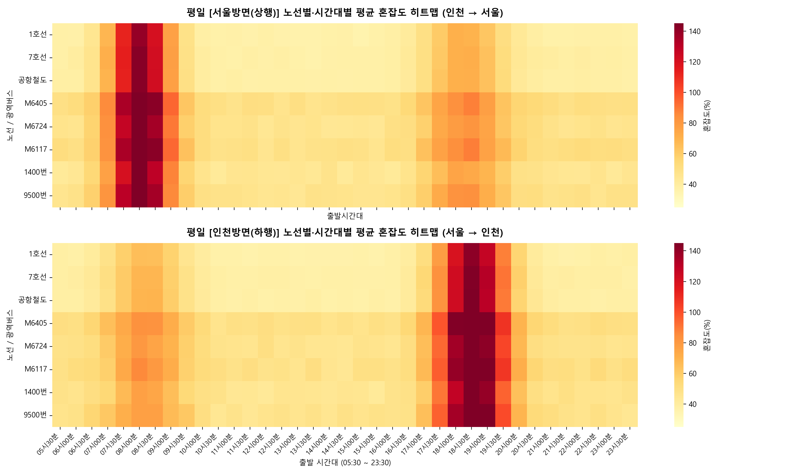
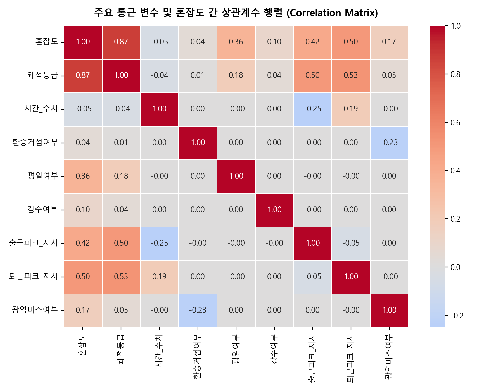
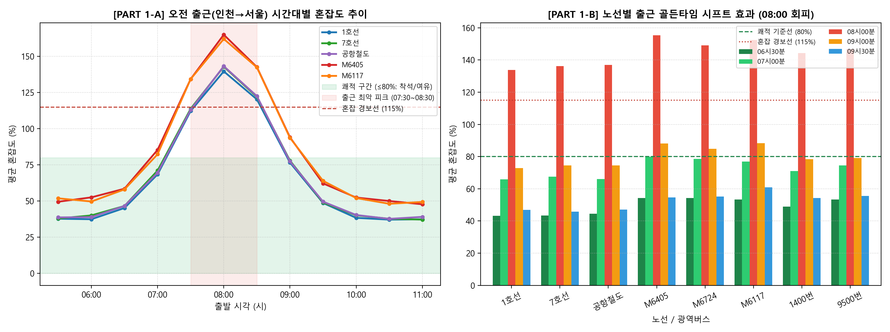
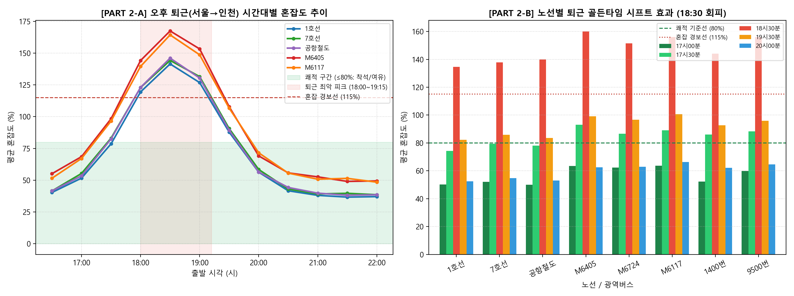
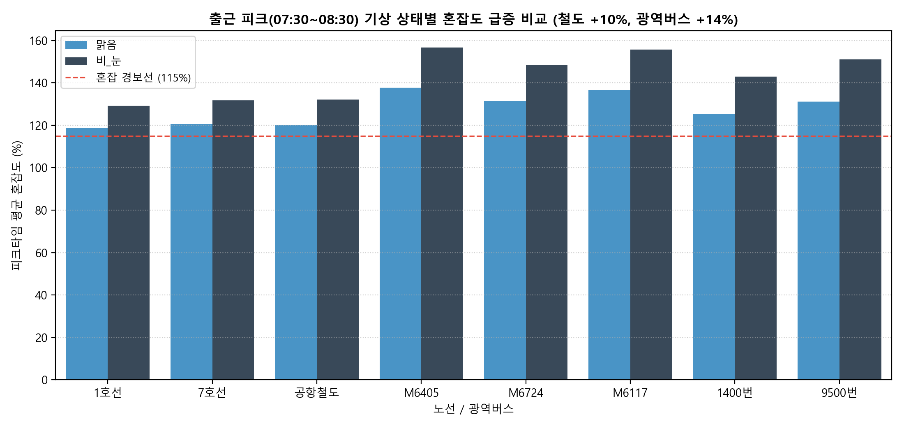
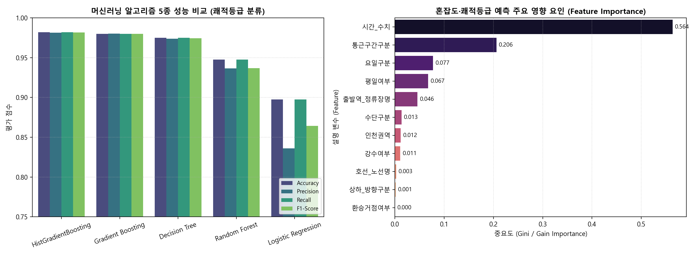

# 🚇🚌 인천–서울 광역통근 최적 골든타임 예측 모델

> **Incheon–Seoul Commute Golden-Time Predictor**
>
> This project analyzes hourly public transit ridership trends between Seoul and Incheon to quantitatively identify and visualize optimal, comfortable commuting times.


---

## 📌 1. 프로젝트 개요 (Overview)

기존 길찾기 서비스는 최단 소요 시간만을 안내할 뿐, 출퇴근 시간대 **혼잡도 $150\%$ 이상**에 달하는 극심한 병목과 광역버스 탑승 대기를 피할 기준을 제공하지 못합니다.

본 프로젝트는 인천–서울 간 핵심 도시철도(3개 노선)와 광역버스(5개 노선)의 시간대별 혼잡도 데이터를 통합 분석하여, **혼잡도 $80\%$ 이하(착석 및 여유로운 이동 가능)인 '쾌적 골든타임'**을 예측하고 추천합니다.

### 🎯 핵심 성과 요약

| 분석 단계 | 핵심 지표 및 결과 | 비고 |
| :--- | :--- | :--- |
| **데이터 규모** | 원천 `432행 × 47열` $\rightarrow$ 패널 **`15,984행 × 17열`** | `pd.melt` 재구조화, 결측 `197건` 중앙값 보간 |
| **최적 분류 모델** | **`HistGradientBoosting` 정확도 `98.19%`** ($F_1 = 0.9817$) | 5종 머신러닝 알고리즘 비교 평가 1위 |
| **혼잡도 회귀 예측** | **`Random Forest Regressor`** $R^2 = 0.9594$ | 연속형 혼잡도 수치 예측 ($\text{RMSE} = 5.44\%\text{p}$) |
| **핵심 영향 요인** | **출발 시각 (`56.36%`) + 통근 구간 (`20.61%`)** | 상위 2개 시간 변수가 전체 예측력의 **`76.97%`** 차지 |
| **실무 시프트 효과** | 피크 시간대 대비 **30~60분 이동 시 혼잡도 최대 `75%p` 감소** | 전 노선 쾌적 등급($\le 80\%$) 달성 가능 |

---

## 🎯 2. 출·퇴근 골든타임 5×5 빙고 도표 (Commute Golden-Time BINGO)

출근 시간대(인천 $\rightarrow$ 서울)와 퇴근 시간대(서울 $\rightarrow$ 인천)별로 **버스·지하철 노선 × 탑승 시간대**를 한눈에 비교할 수 있도록 5×5 빙고 카드 이미지 2종으로 시각화했습니다.

| 🌅 [PART 1] 오전 출근 골든타임 빙고 (인천 → 서울) | 🌆 [PART 2] 오후 퇴근 골든타임 빙고 (서울 → 인천) |
| :---: | :---: |
|  |  |
| **★ ALL-BINGO 출근 시간:** `06:00~07:05` (조기) · `09:30~10:00` (유연) | **★ ALL-BINGO 퇴근 시간:** `17:00~17:20` (조기) · `20:00~21:30` (여유) |

### 📋 노선별 최적 골든타임 요약표 (혼잡도 $80\%$ 이하 기준)

| 구분 | 수단 | 노선명 | 피크 회피 구간 (혼잡) | 추천 골든타임 1 (조기) | 추천 골든타임 2 (여유) |
| :--- | :--- | :--- | :--- | :--- | :--- |
| **오전 출근** (인천$\rightarrow$서울) | 도시철도 | **1호선 · 7호선 · 공항철도** | `07:30~08:30` ($134\sim137\%$) | **`06:00~07:05`** ($43\sim68\%$) | **`09:00~10:00`** ($46\sim74\%$) |
| **오전 출근** (인천$\rightarrow$서울) | 광역버스 | **1400 · 9500번** | `07:30~08:30` ($146\%$) | **`06:00~07:05`** ($51\sim73\%$) | **`09:00~10:00`** ($55\sim79\%$) |
| **오전 출근** (인천$\rightarrow$서울) | 광역버스 | **M6405 · M6724 · M6117** | `07:30~08:30` ($152\%$) | **`06:00~07:05`** ($54\sim78\%$) | **`09:30~10:00`** ($57\%$) |
| **오후 퇴근** (서울$\rightarrow$인천) | 도시철도 | **1호선 · 7호선 · 공항철도** | `18:00~19:30` ($135\sim140\%$) | **`17:00~17:45`** ($50\sim80\%$) | **`20:00~21:30`** ($53\sim55\%$) |
| **오후 퇴근** (서울$\rightarrow$인천) | 광역버스 | **1400 · 9500 · M버스** | `18:00~19:30` ($150\sim156\%$) | **`17:00~17:20`** ($56\sim63\%$) | **`20:00~21:30`** ($63\sim64\%$) |

---

## 📊 3. 탐색적 데이터 분석(EDA) 및 시각화 갤러리

`python main.py` 실행 시 `outputs/figures/` 경로에 자동 생성되는 6종의 핵심 분석 차트입니다.

### ① 양방향 혼잡도 히트맵 및 변수 간 상관관계

| 평일 서울방면(상행)·인천방면(하행) 혼잡도 히트맵 | 주요 통근 변수 및 혼잡도 상관계수 행렬 |
| :---: | :---: |
|  |  |

### ② 출근(Part 1) 및 퇴근(Part 2) 시간대별 추이와 시프트 효과

| [Part 1] 오전 출근(인천$\rightarrow$서울) 추이 및 시프트 | [Part 2] 오후 퇴근(서울$\rightarrow$인천) 추이 및 시프트 |
| :---: | :---: |
|  |  |

### ③ 악천후(비·눈) 영향 및 머신러닝 모델 성능 비교

| 기상 상태(맑음 vs 비·눈)별 피크 혼잡도 급증 비교 | 알고리즘 5종 성능 비교 및 Feature Importance |
| :---: | :---: |
|  |  |

---

## 🤖 4. 머신러닝 모델링 및 변수 중요도

### 모델별 분류 성능 비교 (`Test Set = 20%`, Stratified Split)

| 순위 | 알고리즘 (Model) | Accuracy | Precision | Recall | F1-Score | 평가 요약 |
| :---: | :--- | :---: | :---: | :---: | :---: | :--- |
| **1** | **`HistGradientBoosting`** | **`0.9819`** | **`0.9815`** | **`0.9819`** | **`0.9817`** | **최고 성능 (비선형 시간 패턴 포착 우수)** |
| 2 | `Gradient Boosting` | `0.9800` | `0.9800` | `0.9800` | `0.9800` | 변수 중요도 산출 및 안정적 분류 |
| 3 | `Decision Tree` | `0.9750` | `0.9742` | `0.9750` | `0.9746` | 직관적 규칙 기반 분기 |
| 4 | `Random Forest` | `0.9475` | `0.9365` | `0.9475` | `0.9369` | 배깅 기반 앙상블 |
| 5 | `Logistic Regression` | `0.8974` | `0.8357` | `0.8974` | `0.8644` | 선형 경계 한계로 피크 구간 과소 예측 |

### 혼잡도 예측 주요 영향 요인 (Feature Importance Top 5)

```text
1. 출발 시각 (시간_수치)   ██████████████████████████████████████████████████  56.36%
2. 통근 구간 구분         ██████████████████                                  20.61%
3. 요일 구분 (월/화수목/금) ███████                                              7.73%
4. 평일 여부              ██████                                               6.75%
5. 출발역·정류장명         ████                                                 4.56%
```

---

## 📂 5. 프로젝트 디렉토리 구조 및 실행 방법

### 폴더 구조

```text
incheon-seoul-commute-golden-time/
├── main.py                                    # 전체 파이프라인 원클릭 실행 스크립트
├── requirements.txt                           # 필수 라이브러리 의존성 명세
├── README.md                                  # 프로젝트 문서 및 출퇴근 5×5 빙고 가이드
├── src/
│   ├── __init__.py
│   ├── data_loader.py                         # 공공데이터 원천(Wide-Format) 로딩 및 스키마 생성
│   ├── preprocess.py                          # Melt 변환, 문자열 정제, 중앙값 결측 보간, 타겟 정의
│   ├── eda_visualization.py                   # 탐색적 데이터 분석 및 고해상도 차트 6종 생성
│   ├── train_evaluate.py                      # 분류 5종 + 회귀 1종 학습·평가 및 중요도 산출
│   ├── recommend.py                           # 출근(Part 1)·퇴근(Part 2) 골든타임 추천표 생성
│   └── generate_bingo_png.py                  # 출·퇴근 5×5 빙고 카드 PNG 생성 보조 스크립트
├── data/
│   ├── raw_public_transport_wide.csv          # 원천 데이터 (432행 × 47열)
│   └── preprocessed_incheon_seoul_commute.csv # 전처리 완료 패널 데이터 (15,984행 × 17열)
└── outputs/
    ├── model_comparison_results.csv           # 머신러닝 5종 성능 비교표
    ├── feature_importance.csv                 # 설명변수 중요도 산출 결과
    ├── golden_time_recommendations.csv        # 노선별 출퇴근 골든타임 추천표
    └── figures/                               # 빙고 이미지 2종(SVG) 및 분석 차트 6종(PNG)
```

### 로컬 환경 실행 방법

```bash
# 1. 저장소 클론 및 폴더 이동
git clone https://github.com/<YOUR-USERNAME>/incheon-seoul-commute-golden-time.git
cd incheon-seoul-commute-golden-time

# 2. 필수 패키지 설치
pip install -r requirements.txt

# 3. 전체 분석·모델링·시각화 파이프라인 실행
python main.py
```

---

## 💡 6. 한계점 및 향후 발전 방향

* **집계 단위의 한계:** 현재 `30분` 단위 평균 혼잡도 데이터를 활용했으나, 향후 `10분` 단위 실시간 교통카드 태그 데이터(API)를 결합하면 더욱 정밀한 배차별 예측이 가능합니다.
* **서비스 확장성:** 기상청 초단기 예보 API와 연동하여 비·눈 예보 시 **광역버스 대신 도시철도 전환 및 20분 조기 출발 알람**을 제공하는 개인화 통근 서비스로 확장할 수 있습니다.